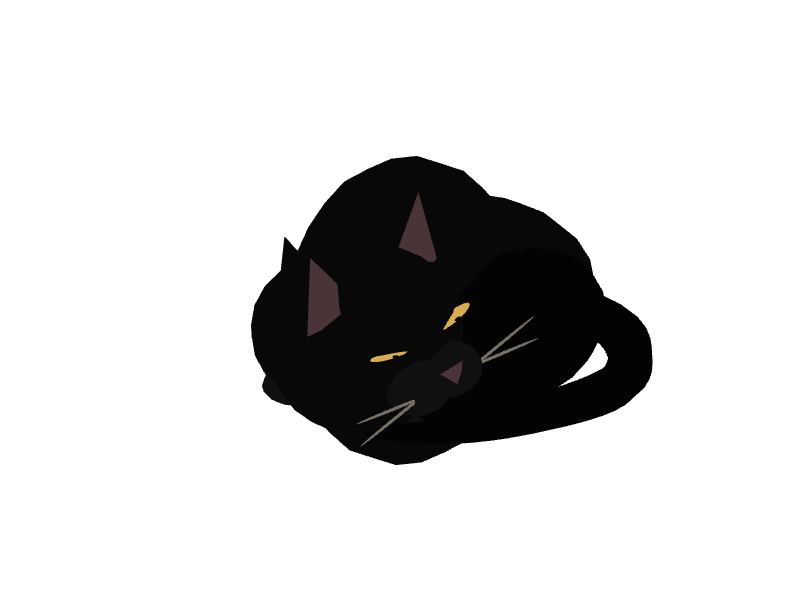
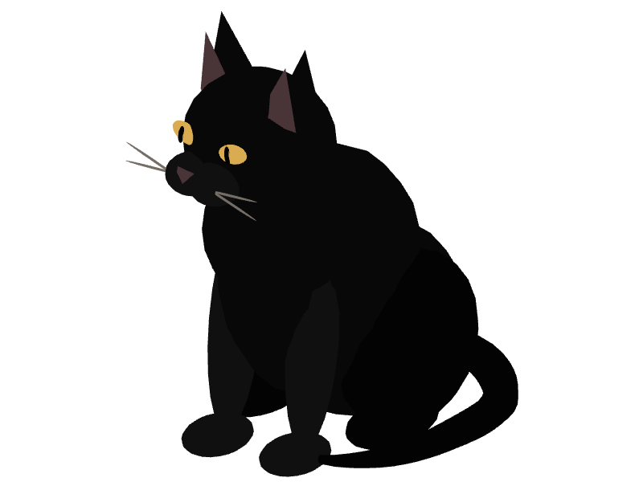

# Three.js cat

A small black cat for a Three.js scene. It sleeps, stretches awake when petted, follows a nearby camera with its eyes and head while sitting, and purrs when petted again. The model and sound are generated at runtime.

Her name is Bonnie, from one of the author's cats.

## Screenshots

| Sleeping | Sitting |
| --- | --- |
|  |  |

## Use in a browser

Copy `cat.js` into your application and import it as an ES module. Pass the same Three.js namespace used to create your scene and camera. The plugin needs no external assets or build step.

```js
import {createCat} from './cat.js';

const BONNIE = createCat(THREE, {
  scene,
  camera,
  position: new THREE.Vector3(0, 1, 0),
  purrDurationMs: 5000,
  awakeDurationMs: 30000,
  rotationY: Math.PI / 4
});
```

## Arguments

### `createCat(THREE, options)`

| Argument | Default | Description |
| --- | --- | --- |
| `THREE` | Required | The Three.js namespace used to create your scene and camera. |
| `options` | Required | Object containing at least `scene` and `camera`. |
| `options.scene` | Required | Parent scene to which the plugin adds the cat. |
| `options.camera` | Required | Camera the cat looks toward and to which the plugin attaches its audio listener on the first audible purr. |
| `options.position` | `undefined` (scene origin) | A `THREE.Vector3` locating the surface beneath the paws in scene coordinates. |
| `options.rotationY` | `0` radians | Starting rotation about the Y axis. At zero, the cat faces local positive Z. |
| `options.state` | New state per cat | Pass a state from `createCatState` to preserve it across scene changes. A supplied state uses its own timing settings. |
| `options.purrDurationMs` | `10000` ms | Initial purr duration for a new state. Each pet during a purr adds twice this duration. Zero disables purring. |
| `options.awakeDurationMs` | `20000` ms | Time after the last pet before a cat with a new state starts lying down. The transition takes another 2500 ms. |
| `options.refDistance` | `2.58` scene units | Distance from the cat at which the purr starts getting quieter. The maximum audible distance is 4.5 scene units. |

### `createCatState(options)`

The optional `options` object defaults to `{}`. It accepts `purrDurationMs` (default `10000`) and `awakeDurationMs` (default `20000`), with the effects described above. Both factories accept finite, nonnegative durations in milliseconds when creating a state.

### Cat and state methods

| Method | Argument | Default | Description |
| --- | --- | --- | --- |
| `cat.update(frame)` | `frame` | `undefined` | Optional frame object. Call before each render to animate the cat. |
| `cat.update(frame)` | `frame.audioContext` | `undefined` | A running Web Audio `AudioContext` allows the plugin to start or extend positional purring. The plugin uses this context as the Three.js audio context. |
| `state.pet(now)` | `now` | `performance.now()` | Interaction time in milliseconds. The first pet wakes a sleeping cat. Another pet while awake starts or extends its purr. Returns whether the cat is purring. |
| `state.pose(now)` | `now` | `performance.now()` | Time in milliseconds at which to evaluate the sitting and stretching weights. |
| `cat.dispose()` | None | — | Removes the cat and releases its geometry, materials, and audio resources. |

Use `cat.state` to access the model’s state. The read-only `state.purrUntil` property gives the purr end time on the same clock as `pet` and `pose`.

## Agent skill

[Three-cats integration skill](skills/three-cats/SKILL.md) covers scene setup, petting, positional audio, and cleanup.

## License

Copyright Federico Razzoli 2026.
GNU Affero General Public License, version 3 only. See LICENSE.
